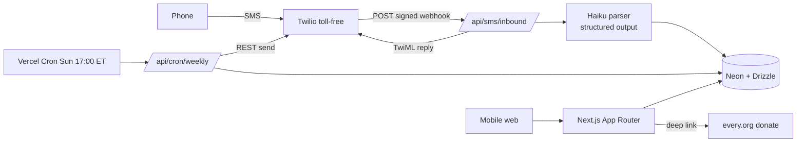

# Tech Preflight — Donate the Difference
_tech-lead · 2026-10-18 · pre–Gate A (nothing scaffolded or provisioned)_

## 1. Architecture sketch

**Routes:** `/` manifesto+onboarding · `/goal` · `/verify` · `/text-us` · `/login/[token]` (magic link) · `/dashboard` · `/settle` · `/issue/[n]` (owner) · `/i/[shareId]` (public card, OG image) · `/goal-reached` · `/legal/{privacy,terms,sms}`.
**API:** `POST /api/auth/start` (send 6-digit code) · `POST /api/auth/verify` · `POST /api/sms/inbound` (X-Twilio-Signature validated; idempotent on `MessageSid`) · `GET /api/cron/weekly` (Bearer `CRON_SECRET`; idempotent on `user_id+week`) · `POST /api/settle/confirm` · `/api/studio/assets` (STUDIO_TOKEN, disabled in prod).
**Neon schema (Drizzle):**
- `users` id, phone_e164 (unique), status (active|stopped), tz, created_at, consent_at, consent_source
- `goals` id, user_id, label, target_cents, active, reached_at
- `skips` id, user_id, goal_id, item, price_cents, category, charity_id, pledge_cents, raw_text, message_sid (unique), undone_at
- `charities` id (slug), name, every_org_slug, category, impact_unit_cents, impact_label, source_url
- `issues` id, user_id, number, week_start, totals_json, share_id, sent_at — unique(user_id, week_start)
- `settle_ups` id, user_id, issue_id, charity_id, amount_cents, partner_donation_id, clicked_at, confirmed_at
- `auth_codes` / `sessions` phone, code_hash, expires_at, attempts; token_hash, expires_at, used_at
- `messages` sid, direction, user_id, body, intent, parse_ms, error (audit + analytics)

**Parser:** Haiku via AI SDK `generateObject` + Zod: `{intent: skip|totals|new_goal|undo|help|other, item?, price_cents?, category?: food|drink|transport|fashion|tech|home|fun|other, goal_label?, goal_cents?}`. Regex fast-path first (`^(.+?)\s+\$?(\d+(\.\d{2})?)$`, STOP/HELP/UNDO/TOTALS keywords — STOP/HELP never touch the LLM). Timeout 4s → fallback reply "Got it — what did it cost? e.g. 'croissant 5'". Price only from user text; validator rejects LLM-invented prices. Category→charity via fixed `charities` map. Golden set ≥60 cases in `ai/evals/`. Twilio webhook budget 15s; we target <3s.

**Magic link via SMS:** "dashboard" text or web login → single-use token (15 min, hashed), sets httpOnly signed session cookie (30 days, `SESSION_SECRET`).

**Every.org (verified):** `https://www.every.org/<slug-or-EIN>?amount=<n>&frequency=ONCE&success_url=<enc>&partner_donation_id=<id>#donate` — query params before the `#donate` fragment. `success_url` returns to `/settle?done=<id>` for auto-confirm; "I donated" button as fallback. Source: [docs.every.org/docs/donate-link](https://docs.every.org/docs/donate-link). Webhook confirmation (`webhook_token`) needs a partner account — v2.

**Security:** all secrets server-only; Twilio signature check; rate limit codes (5/hr/phone); STOP sets `status=stopped` and suppresses all sends; no money custody; phone numbers never in client bundles or public card.

## 2. Twilio path (researched)
| Item | Finding |
|---|---|
| Toll-free number | **$2.15/mo** ([Twilio US pricing](https://www.twilio.com/en-us/sms/pricing/us)) |
| SMS (US, toll-free) | **$0.0083/segment** in and out, plus carrier fees ~$0.0035–0.005 out, ~$0–0.0035 in; $0.001 per failed msg (same source) |
| Verification fields | Legal entity name, **EIN for US entities** (BRN mandatory for new submissions since 2026-02-17, **except sole proprietors**), live website, street address, contact, use case + summary, 2–5 sample messages (brand name, opt-out phrase, full https URLs), opt-in proof viewable without login, **Privacy + Terms URLs mandatory since 2026-09-15** (error 30493), monthly volume ([onboarding guide](https://support.twilio.com/hc/en-us/articles/13264118705051-Toll-Free-Verification-Onboarding-Guide), [BRN changelog](https://www.twilio.com/en-us/changelog/business-registration-numbers-required-for-toll-free-messaging-p)) |
| LLC vs sole prop | **Yardboat LLC with its EIN is the strongest route.** Sole-prop is allowed (`SOLE_PROPRIETOR`, no BRN) but tends to trigger manual review, ID upload ([API onboarding](https://twilio.com/docs/messaging/compliance/toll-free/api-onboarding), [Telnyx note](https://support.telnyx.com/en/articles/13765655-compliance-catch-up-why-toll-free-verification-now-mirrors-10dlc)) |
| Approval time | Twilio states **review within 3 business days**; rejections editable for 7 days. Plan for 3–7 business days, longer with one resubmit. |
| Sending while pending | **Blocked.** Pending/Restricted toll-free numbers cannot send to US mobiles (error 30032, since 2024-01-31), and blocked messages are still billed ([30032](https://www.twilio.com/docs/api/errors/30032)) |
| Trial for dev | Trial toll-free must also be verified before sending; then only to verified caller IDs. Inbound works. **Twilio Virtual Phone** works for dev with no verification ([trial limits](https://support.twilio.com/hc/en-us/articles/11853148778523-Trial-Limits-and-US-Toll-Free-Number-Restrictions), [dev restrictions](https://support.twilio.com/hc/en-us/articles/20212966914075-Toll-Free-Verification-and-Developers-Navigating-the-New-Restrictions)) |

**Recommendation (fastest path to 5–10 testers):** At Gate A Randall upgrades Twilio to paid (prepay $20), buys one toll-free number, and submits TFV **as Yardboat LLC + EIN** in week 1. TFV needs live URLs, so P2 ships the legal pages + opt-in page to a public preview URL **first** (days 1–2) and verification is submitted on day 2–3. Dev runs on Virtual Phone + a local webhook test harness meanwhile. Approval expected ~day 6–10, well before the ~11-08 target. Fallback if rejected: fix + resubmit within 7 days. Note: the use case is "Account notifications / Customer care", volume "1,000".

## 3. Env vars
| Name | Purpose | Provided by |
|---|---|---|
| ANTHROPIC_API_KEY | Haiku parser | Shared, exists |
| GEMINI_API_KEY | Production imagery (studio route) | Shared, exists |
| DATABASE_URL (+ DATABASE_URL_UNPOOLED) | Neon Postgres | Auto-injected by Neon Vercel Marketplace integration. Vercel MCP can list integrations but has no Neon-install tool, so **Randall installs Neon from the Vercel dashboard (one click, free plan)** — clearance item |
| TWILIO_ACCOUNT_SID | Twilio REST + signature check | Randall (Twilio console) |
| TWILIO_AUTH_TOKEN | Same; webhook validation | Randall |
| TWILIO_PHONE_NUMBER | Toll-free sender, E.164 | Randall (after purchase) |
| SESSION_SECRET | Signs session cookies + magic tokens | Generated by Claude, set via Vercel MCP |
| CRON_SECRET | Guards `/api/cron/weekly` | Generated by Claude, set via Vercel MCP |
| STUDIO_TOKEN | Guards `/api/studio/assets` | Generated by Claude |
| NEXT_PUBLIC_APP_URL | Absolute links in SMS / OG | Claude |

## 4. Cost forecast (v1 build + 4 weeks × 10 testers)
Assumptions: 40 texts/tester/wk = 20 in + 20 out, 1 segment each (GSM-7, ≤160 chars, no emoji in SMS); ~300 dev/QA msgs; avg out $0.0128, in $0.0103 incl. carrier fees.
| Line | Calc | Est. |
|---|---|---|
| Twilio number | $2.15 × 2 mo | $4.30 |
| Twilio tester SMS | 10 × 4 × (20×$0.0103 + 20×$0.0128) | $18.48 |
| Twilio dev/QA SMS | ~300 msgs | $3.50 |
| Claude Haiku | ~1,200 parses + evals, ~1k tokens each | ~$2 |
| Gemini imagery | ~30 textures/stamps/card art | ~$3 |
| Neon | Free plan (0.5 GB) | $0 |
| Vercel | Existing team; weekly cron within limits | $0 |
| Domain | ≤$10 rule | $9.99 |
| **Total** | | **~$41** |

**Over the $30 pre-approval by ~$11.** Recommend Gate A ceiling **$50**. (Twilio's $20 upgrade prepay is credit, not extra spend.) To stay under $30: skip the domain until production "go" (−$9.99 → ~$31) and keep receipts short.

## 5. Draft tickets (P2–P7)
| ID | Title | Agent / tier |
|---|---|---|
| DTD-01 | Scaffold Next.js, kit, Vitest/Playwright, Vercel link | tech-lead / Opus |
| DTD-02 | Drizzle schema + migrations + charities seed | builder / Sonnet |
| DTD-03 | Legal + SMS opt-in pages live (TFV prerequisite) | writer → builder / Sonnet |
| DTD-04 | TFV submission pack (samples, use case, opt-in screenshot) to clearance | physital-engineer / Sonnet |
| DTD-05 | Charity map: category→Every.org slug + sourced impact units | strategist / Opus |
| DTD-06 | Parser prompt + Zod schema + regex fast-path | ai-systems-engineer / Opus |
| DTD-07 | Parser golden set (60+) + eval runner | ai-systems-engineer / Opus |
| DTD-08 | Inbound webhook: signature, idempotency, intent router | physital-engineer / Sonnet |
| DTD-09 | Reply copy: receipts, totals, goal, undo, clarify, STOP/HELP | writer / Sonnet |
| DTD-10 | Ledger logic: skip, undo, new goal, totals, goal reached | builder / Sonnet |
| DTD-11 | Phone verify + SMS magic-link auth + sessions | builder / Sonnet |
| DTD-12 | Design tokens + Xerox zine kit (textures, stamps, type) | art-director / Opus |
| DTD-13 | Imagery generation via studio route (Gemini) | asset-producer / Sonnet |
| DTD-14 | Manifesto scroll onboarding + goal setup + text-us handoff | craft-engineer / Opus |
| DTD-15 | Dashboard: goal progress, impact lines, "Issue NN drops Sunday" | builder / Sonnet |
| DTD-16 | Weekly issue builder + recap card (owner + public + OG image) | craft-engineer / Opus |
| DTD-17 | Sunday cron send (idempotent, timezone, STOP-aware) | physital-engineer / Sonnet |
| DTD-18 | Settle-up: Every.org deep links + success_url confirm + fallback | physital-engineer / Sonnet |
| DTD-19 | Signature motion moment (goal object assembling) | craft-engineer / Opus |
| DTD-20 | Analytics: skips/tester/week events + admin view | builder / Sonnet |
| DTD-21 | Full QA 390/1440, all states, SMS loop E2E | qa-critic / Opus |
| DTD-22 | Tester onboarding kit + prod promote + domain | launch-ops / Sonnet |

Dependencies: 01→02→(08,10,11); 03→04 (critical path for TFV); 05→10,18; 06→07→08; 09→08; 12→13→14,16; 10→15,16→17; all→21→22.

## Clearance checklist additions
1. Twilio: upgrade to paid ($20 prepay), buy toll-free number, paste 3 Twilio env vars. 2. Submit TFV as Yardboat LLC with EIN (we prepare the full pack; Randall clicks submit). 3. Install Neon integration on the Vercel project. 4. Approve $50 ceiling.
